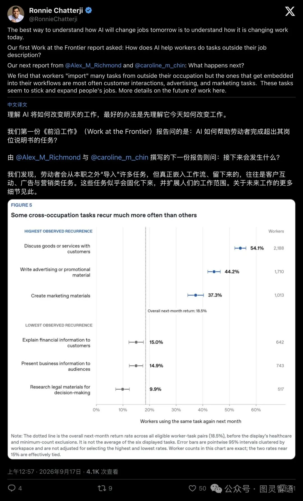

全世界都在为AI失业潮焦虑得睡不着觉。

打开社交平台，随处可见各种警报：程序员要被替代了、初级画师接不到单了、翻译和客服正在成批消失。  
人类似乎正坐在一列失控的高铁上，眼睁睁看着熟悉的工种被推下悬崖。

然而，就在所有人都在拿着放大镜清点“哪份工作会死”的时候，OpenAI的顶级智囊团却突然推翻了整个牌桌。

OpenAI首任首席经济学家罗尼·查特吉（Ronnie Chatterji）与应用科学家哈里森·萨切尔（Harrison Satcher）联手扔出一篇核弹级专栏文章。  
标题只有短短几个单词，却像一记耳光抽醒了整个经济学界：

**《我们还没有这些名词》（We don’t have the nouns yet）。**

他们的核心结论冷酷而震撼：**眼下所有关于“AI消灭就业”的恐慌计算，从一开始就全算错了。**

人类语言的演进，往往跟不上技术裂变的速度。  
面对未来，最让人始料未及的盲区在于：**那批即将承载亿万人生计的全新职业，在今天的字典里，连一个能叫出来的名字都还没有。**
https://economicsofai.substack.com/p/we-dont-have-the-nouns-yet

## 01穿越到1976年：一场令人窒息的思想实验

为了把这个道理讲透，OpenAI团队设计了一个极度荒诞却直击要害的思想实验。

假设你坐上时光机，**穿越回整整50年前的1976年**。

在那个满大街都是机械打字机、黑白电视机和大部头纸质百科全书的时代，你抓住街上一个年轻人，神情严肃地告诉他：

“朋友，别担心未来，我来自2026年  
在我的时代，最赚钱的职业之一叫，**‘基于云端流媒体视频移动应用的搜索引擎广告投放优化师’**。”

对方一定会觉得你刚从精神病院跑出来。
为什么？  
因为这句话里的**几乎每一个名词，在1976年都是彻头彻尾的外星黑话**：

- 什么是“移动应用”？（当时连砖头一样的初代大哥大都没影）；
    
- 什么是“流媒体”？（当时看录像还得塞大号磁带）；
    
- 什么是“云端”？（那会儿计算机占地整整一间房，所谓云只是天上的水汽）；
    
- 什么是“搜索引擎”？（商业互联网还要等二十年后才诞生）。
    

在向1976年的人解释这份工作之前，你必须先给他上一整门涵盖微电子、卫星通信、光纤网络、关系型数据库和移动互联网的技术史课程。

看懂这个死局了吗？

1976年的人，能毫不费力地理解“报纸排字工的饭碗要被砸了”**、**“电报接线员要完蛋了”，因为那是旧名词的消亡，每个人肉眼可见；

但他**绝对无法相信**，未来会凭空冒出数百万个天天对着小玻璃屏“调算法投流”的高薪岗位。

麻省理工学院（MIT）劳动经济学泰斗戴维·奥托（David Autor）的重磅研究给出了一个冰冷的数据：**2018年全美就业市场上的绝大多数工种，在1940年的官方职业普查名录里，根本不存在！**

整整**60%的当代工作**，是过去八十年里从零被“造”出来的。

再看看今天全美养活了125万人的**“网络安全分析师”**。  
在1970年代以前的全球英文图书里，“Cybersecurity”这个词的出现概率几乎就是大鸭蛋。  
人类根本没有造出这个名词，但这不妨碍它今天成为年薪百万的黄金赛道。

**看不见，不代表它不会发生；  
尚未构想，绝不等于不存在**

## 02招聘前线已经在疯狂“造词”了

不要以为“新名词”的诞生是几十年后的远虑。

只要把目光从宏观经济学家的陈旧图表，转向全球劳动力市场高频脉搏，你就会发现：**一线企业的HR们，早就被逼得在招聘启事里疯狂“自创词汇”了。**

全球劳动力市场分析巨头Lightcast调取了数以亿计的实时在线招聘启事，捕捉到一个震碎认知的信号：

在全美所有**传统IT与软件开发行业之外**的普通白领岗位中，明确要求掌握“生成式AI技能”的招聘需求，**在过去两年内暴增了整整9倍（900%）！**

这股海啸根本没发生在程序员圈子里，它直接撞向了市场营销、HR初筛、财务审计、法律合规与客户服务。

与此同时，领英（LinkedIn）的全球经济图谱监测显示：仅在2023到2025短短两年间，全球劳动力市场就自发涌现了**130万个全新的AI深度绑定角色**。

看看今天大厂薪酬序列里，那些几年前根本没人听过的怪异头衔吧：

- **前沿部署工程师（Forward-Deployed Engineers, FDE）：**
    
     这类岗位介于底层模型研发与传统业务集成之间，直接“空投”进跨国银行、老牌工业车间，任务是把沉淀多年的老旧业务数据库，通过API接口连入大模型。
    
- **AI成本精算师（AI Cost Management Analyst）：**
    
     美国电信巨头T-Mobile已经开始公开抢夺这类人才。随着全员调用大模型，公司每个月面对的是数百万美元的Token账单。这个岗位的职责，就是像精算师一样天天盯盘：哪些低难度日常活儿可以“降级”路由给便宜开源小模型？哪些高危商业决策必须花重金调用高阶前沿大模型？
    
- **上下文架构师与Agent编排师（Context Engineer）：**
    
     早期被炒上天的“提示词工程师”光速降温，取而代之的是设计人类、自主智能体与本地知识库三者之间如何流转协作的复杂系统架构师。
    

技术史学者发出了极其辛辣的类比：**现在的这些古怪新职位，像极了1995年互联网刚爆发时的“网管（Webmaster）”。**

在1995年，一家公司招一个“网管”，要求他一个人包办接网线、拧螺丝、写静态HTML网页、配置服务器以及去早期的雅虎手动提交网址。  
那是一个混乱杂糅的过渡名词

随后的十年里，“网管”这个词轰然解体，裂变出了今天庞大无比的现代职业族谱：前端工程师、后端开发、DevOps运维、SEO运营、UI设计师、网络安全专家……

今天的所谓“AI岗位”，正处于大裂变前夜那混沌而暴烈的破晓时刻。
## 03“邻近可能”：火箭、卫星与滴滴司机的锁链

为什么经济学家无论多么聪明，都无法在办公室里为你画出十年后的职业清单？

因为技术与职业的演化，遵循着复杂科学中著名的**“邻近可能”（Adjacent Possible）法则**。

你无法跳过当前的门槛，去打开第四道门后面的宝箱。  
**每一项划时代的发明，本质上都在重置下一阶段“能造什么”的物理边界。**

试想一下这条残酷而壮丽的因果链条：

1. 二战后的军事竞争，让人类研发出了能冲出大气层的**重型火箭**；
    
2. 有了火箭，我们才有可能把人造**卫星**送入近地轨道；
    
3. 轨道上铺满了卫星，冷战军方才顺理成章研发出全球定位系统（**GPS**）；
    
4. GPS与电容触控屏技术结合，苹果才在2007年造出了第一代**智能手机**；
    
5. 智能手机人手一部、移动基站漫山遍野之后，**滴滴与Uber的打车软件算法**才具备成立的商业逻辑；
    
6. 最终，全球数千万名靠算法派单的**网约车司机、外卖骑手、路线优化运营专家**，才作为一个庞大阶层登上了历史舞台。
    

如果你站在1950年第一枚火箭升空的发射台前，指着火箭尾焰对旁边的人说：“看着吧，这玩意儿最终会创造出一种坐在铁盒子里用手指戳玻璃屏接单送外卖的工作。”

全人类都会把你当成疯子

**这就是“邻近可能”**  
 当大模型刚刚把多模态理解与逻辑推理的基石夯进地基时，围绕它生长的下一层商业形态甚至都还没成型。  
要求今天的我们精准叫出十年后最火爆职业的“名词”，无异于要求莱特兄弟在木制滑翔机上撰写《波音747国际空乘服务指南》。

## 04残酷的齿轮差：词汇追上现实之前，人先要吃饭

然而，这篇报告带来的绝非廉价的科技乐观主义狂欢。

在OpenAI推文的下方，一位网友留下的评论引发了广泛共鸣：

> “我们整天争论哪个工种会消失。  
> 但更痛苦的现实是，未来的岗位甚至连名字都还没造出来。  
> **可是在词汇追上现实之前，人总得先吃饭啊！**”

这才是最深层、最真实的时代之痛

**技术的摧毁力是瞬时的，而制度、语言与人性的重建是漫长滞后的。**

历史的残酷经验无情地告诉我们：**技术创造的新机会，极少在同一时间、同一地点、以同一批被冲击的人为对象出现。**

- 一个今天在传统外包公司被AI代码工具优化掉的45岁程序员，很难在明天早晨无缝变身为抢手的“前沿部署工程师”；
    
- 一个被自动化翻译软件砸掉饭碗的初级文员，不可能一夜之间掌握“Token经济学”去大厂竞聘成本分析师；
    
- 麻省理工学院的研究早就指明了历史惯性：**战后历次技术革命催生出的“新工种”，永远最先被更年轻、受教育程度更高、身处超大城市的劳动力群体吃干抹净。**
    

这就是历史剧烈转型期最刺骨的**“齿轮差”**。

旧工种正在加速退场，新工种的命名依然空白。  
在这段漫长的词汇真空中，成千上万普通人面对着职业认同瓦解与切实的生计压力。

苏黎世大学经济学教授 Yanagizawa-Drott 在转发 OpenAI 的推文时，留下了一句意味深长的高级嘲讽：

> **“如果超级智能真有那么神，它最该证明自己的能力，就是准确预测出它自己到底能创造出哪些带‘名词’的新工作。那才算一个了不起的世界模型。”**

## 05终局觉醒：别把今天的工位，当成人类能力的边界

在接受《巴伦周刊》（Barron's）播客专访时，被问及对未来的终极看法，OpenAI首席经济学家查特吉给出了明确回答：

**“我对人类保持极度乐观（Pretty bullish on humans）。”**

这位经济学家强调：在总量失业率的微小起伏之下，更深刻的质变正在每个人的工位上无声发生。

在OpenAI追踪的真实工作流中，**有43.5%的打工人正在使用AI接管原本属于“其他专业领域”的杂活**。

一个独立设计师开始用大模型跑复杂的市场竞品SQL分析；  
一个中学教师开始用Agent搭建高度个性化的自动判卷系统；  
一个基层HR正在用AI自己写轻量级内部管理工具。

**岗位的名字还没有变，但人们手里干的活，早就越过了职业说明书的边界。**

如果说这篇引发硅谷震荡的研究能给当下的我们带来什么终极启示，那就是：

**永远不要用今天的工种名录，去丈量人类未来的可能性边界。**

技术确实正在重塑现有行业  
但在漫长的产业史上，推动就业版图持续扩张的，始终是那些伴随新技术诞生、此前未曾设想过的新型分工。

别再把自己局限在那张薄薄的“职位描述（Job Description）”里了。

那个困住你的旧名词正在瓦解；  
而那个属于你的全新头衔，世界正等着你去亲手填空。
